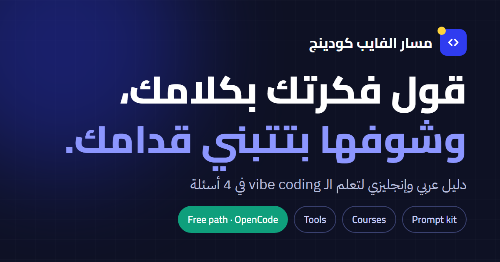
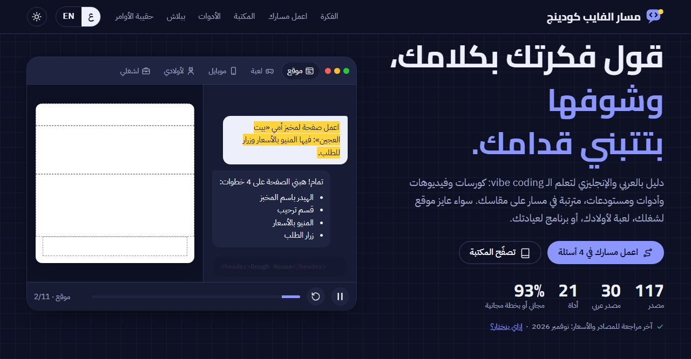
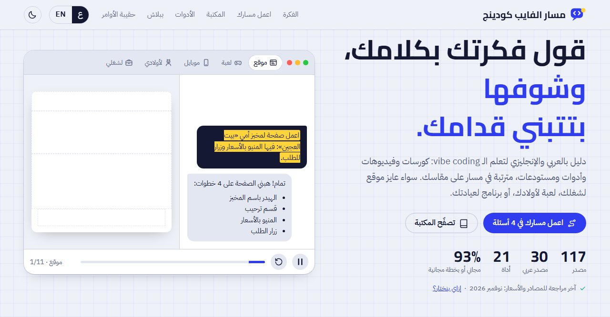
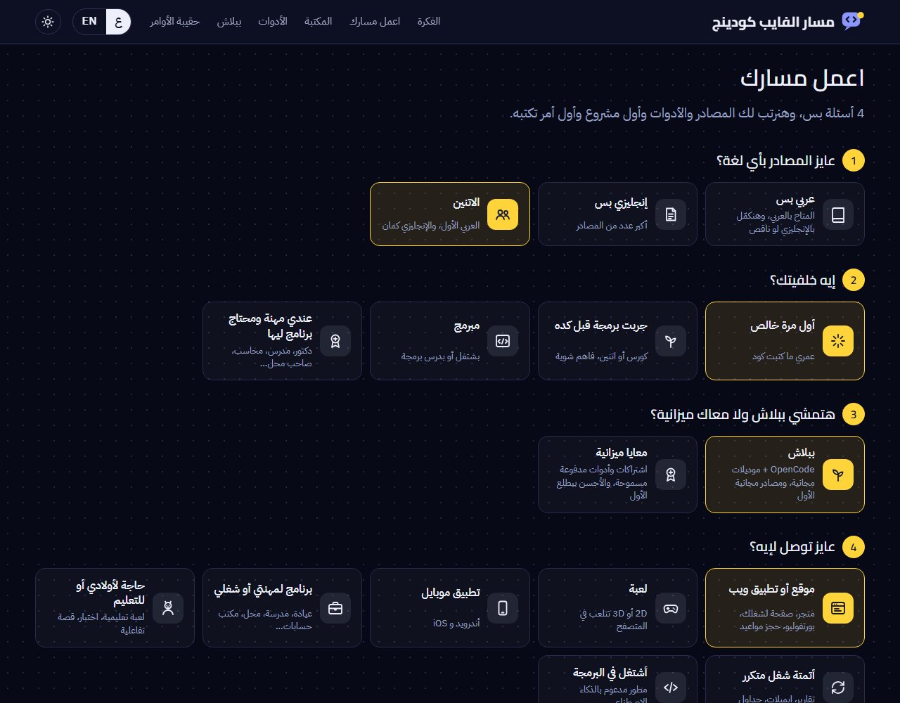
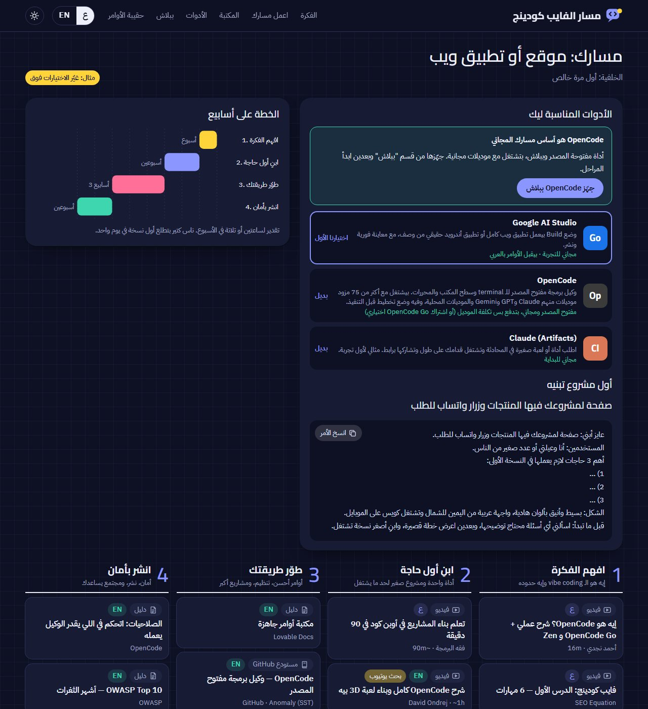
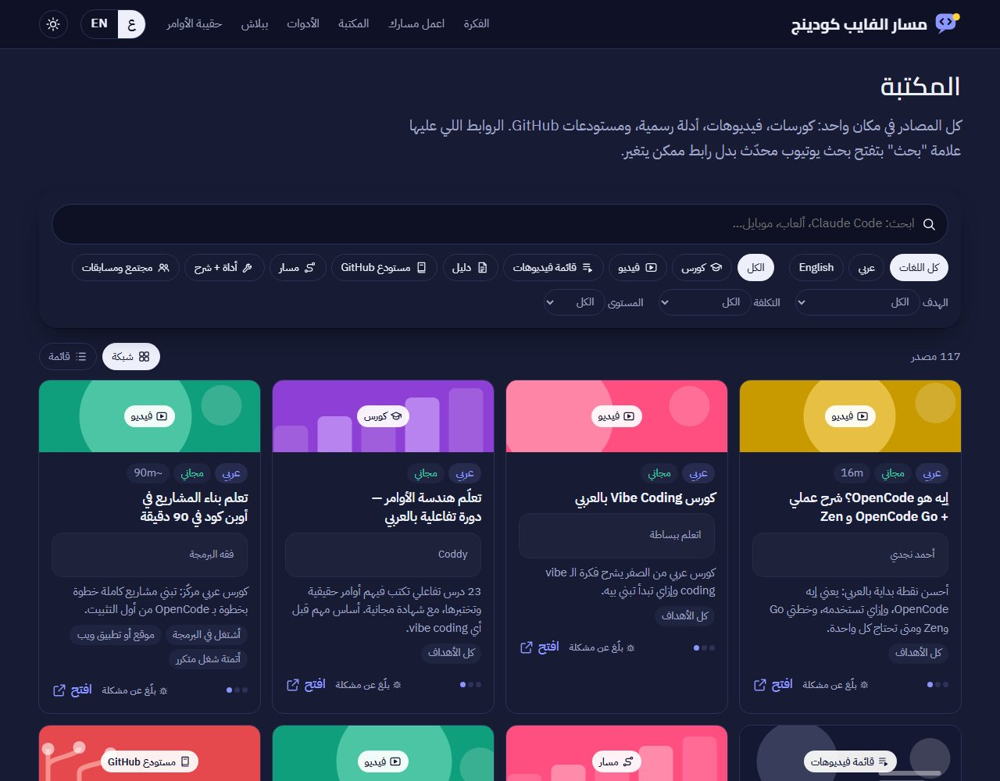
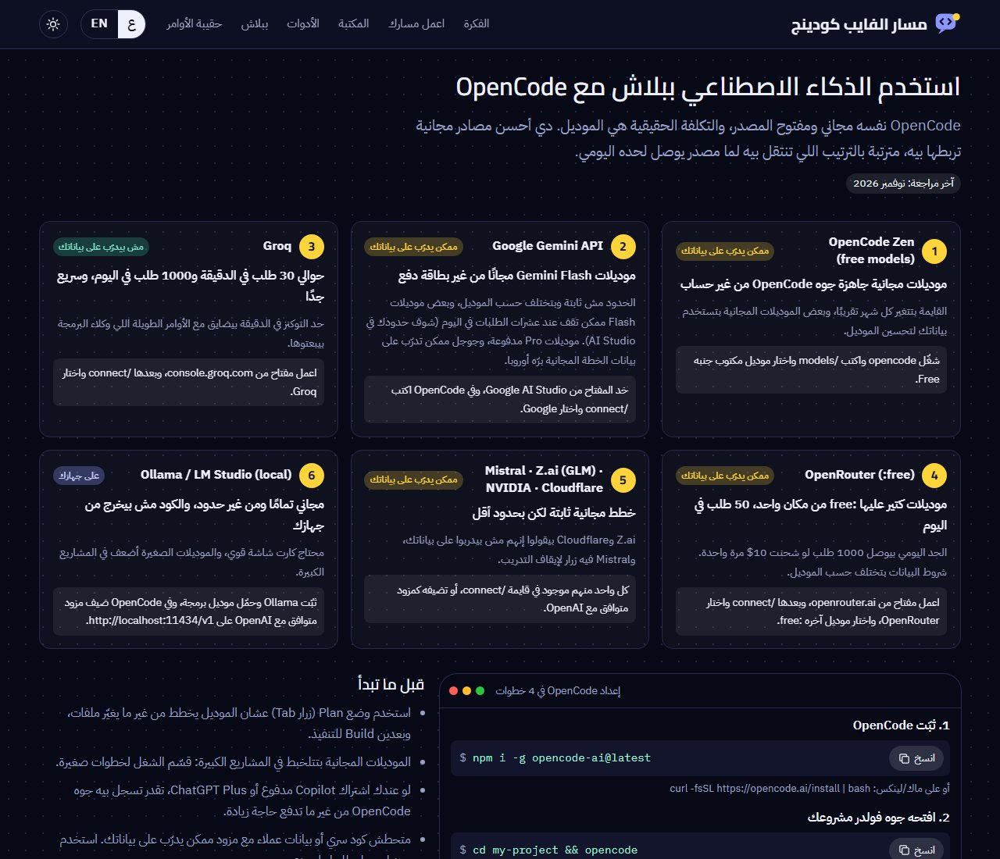
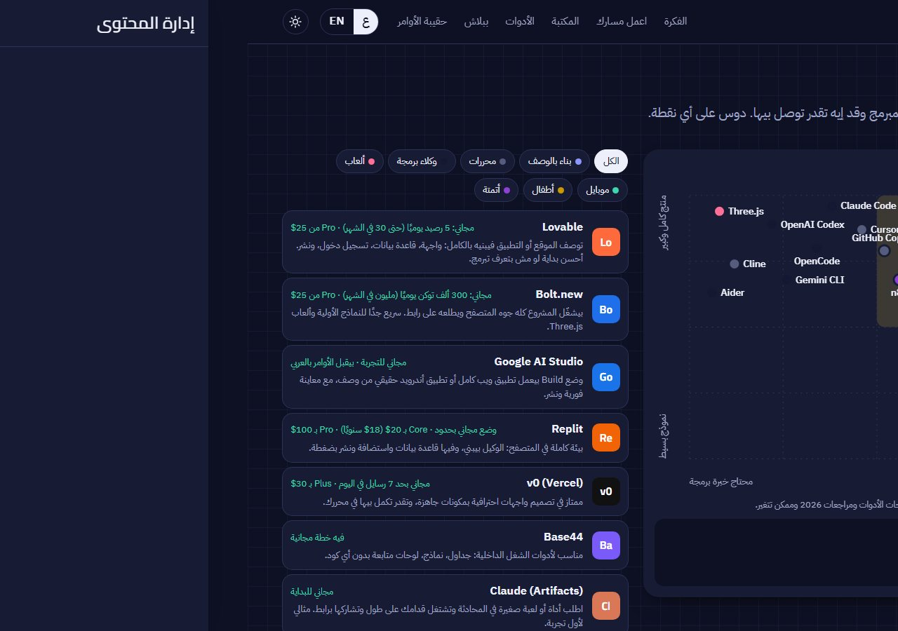
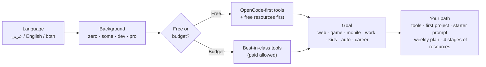

<div align="center">



# مسار الفايب كودينج · Vibe Coding Path

**دليل عربي وإنجليزي لتعلّم الـ vibe coding: اعمل مسارك في 4 أسئلة، وابدأ ببلاش مع OpenCode.**
**A bilingual guide to learning vibe coding: build your path in 4 questions, and start free with OpenCode.**

<br>

[](https://ahmadmansy.github.io/vibe-coding-path/)
[](LICENSE)


[**Open the site**](https://ahmadmansy.github.io/vibe-coding-path/) &nbsp;·&nbsp; [Suggest a resource](https://github.com/ahmadmansy/vibe-coding-path/issues/new) &nbsp;·&nbsp; [Run it locally](#-run-it-locally) &nbsp;·&nbsp; [بالعربي](#-بالعربي)

</div>

<br>

<table>
  <tr>
    <td width="50%"></td>
    <td width="50%"></td>
  </tr>
</table>

---

## ✨ What is this?

Most "learn vibe coding" lists are a pile of links. This site asks **four questions** and turns the pile into **a plan that fits you**: the right tools, a first project to build, a ready-to-paste starter prompt, a week-by-week timeline, and four stages of hand-picked resources.

- 🧭 **Personal path**: language, background, free-or-budget, goal.
- 🆓 **Free path built around [OpenCode](https://opencode.ai)**: pick "free" and paid resources drop out, OpenCode becomes the core tool, and its tutorials move to the front.
- 📚 **100+ resources** (courses, videos, guides, repos), filterable by language, type, cost, level and goal.
- 🗺️ **Tool map** that places 20+ tools on *ease vs. depth*.
- 🔌 **Free AI providers for OpenCode** with real limits, privacy notes and copy-paste setup commands.
- 🧰 **Prompt kit and 9 golden rules** so your first project doesn't end in a mess.
- ⚠️ **"When not to rely on vibe coding"**: money, login, people's data, anything that can hurt someone, plus habits that keep you safe.
- 🌗 Arabic (RTL, default) and English · light and dark · keyboard friendly · no tracking.

## 🖼️ A look inside

<table>
  <tr>
    <td width="50%" valign="top"><b>1 · Four questions</b><br></td>
    <td width="50%" valign="top"><b>2 · Your path</b><br></td>
  </tr>
  <tr>
    <td width="50%" valign="top"><b>3 · The library</b><br></td>
    <td width="50%" valign="top"><b>4 · Free AI with OpenCode</b><br></td>
  </tr>
</table>

<details>
<summary><b>Tool map</b></summary>
<br>

</details>

## 🧭 How the path is built



Every resource is scored against your answers (`scoreRes` in [`assets/app.js`](assets/app.js)): goal match, background fit, level, language, cost and an OpenCode boost on the free path. The top picks per stage become your path:

| Stage | Goal |
|:-:|---|
| **1** | Get the idea: what vibe coding is, and where it stops |
| **2** | Build your first thing: one tool, one small project |
| **3** | Level up: better prompts, structure, bigger projects |
| **4** | Ship safely: security, publishing, community |

## 🚀 Run it locally

There is **nothing to install**. It's plain HTML + CSS + vanilla JS.

```bash
git clone https://github.com/ahmadmansy/vibe-coding-path.git
cd vibe-coding-path

python3 -m http.server 8000     # then open http://localhost:8000
# or:  npx serve
```

Opening `index.html` directly (`file://`) works too.

## 🗂️ Project structure

```text
vibe-coding-path/
├── index.html              page structure, icon sprite, data-i18n keys
├── assets/
│   ├── app.js              all logic (one IIFE) + the ar/en dictionary
│   ├── app.css             all styles, light/dark tokens, accent presets
│   ├── fonts/              self-hosted woff2 (Cairo, IBM Plex), OFL
│   ├── favicon.svg
│   └── og.png              1200×630 social preview
├── data/
│   ├── resources.js        every learning resource (schema at the top)
│   ├── tools.js            tools for the map
│   ├── content.js          wizard options, stages, tool picks, prompts, rules
│   └── free.js             free OpenCode providers + setup steps
├── scripts/
│   └── check-links.js      validates the data and checks every link
├── docs/screenshots/       images used in this README
├── 404.html · robots.txt · sitemap.xml
└── LICENSE · README.md
```

## ➕ Add a resource

Everything lives in `data/resources.js`. Add one object, always with **both** languages:

```js
{
  id: "my-new-resource",            // unique, letters/numbers/dashes
  type: "video",                    // course | video | playlist | guide | repo | path | community | tool-guide
  lang: "ar",                       // language of the content itself
  cost: "free",                     // free | freemium | paid
  level: "start",                   // start | grow | pro
  stage: 2,                         // 1 idea · 2 first build · 3 level up · 4 ship safely
  goals: ["web", "work"],           // or ["all"]
  who: ["zero", "some"],            // zero · some · dev · pro, or ["all"]
  url: "https://example.com/the-direct-link",
  provider: "Channel or site name",
  duration: "45m",                  // optional
  title: { ar: "العنوان", en: "Title" },
  desc:  { ar: "وصف قصير", en: "A short description" },
  tags: ["opencode"],               // optional: shows it in the "Learn OpenCode" grid
  featured: true                    // optional
}
```

Then check it:

```bash
node scripts/check-links.js            # schema + every link (Node 18+)
node scripts/check-links.js --offline  # schema only, instant
```

The checker catches duplicate ids, bad values, a missing Arabic or English string, tools that don't exist in the picks, affiliate parameters, and dead links. YouTube videos are checked through oEmbed, because a removed video still returns `200` on its page.

## 🔄 Keeping it fresh

Prices and free tiers change every few months, so this is a living list:

1. Run `node scripts/check-links.js`.
2. Re-check prices in `data/tools.js` and limits in `data/free.js` against each tool's own pricing page.
3. Update the **last reviewed** date in all three places: `hero.reviewed` and `foot.p1` (in `assets/app.js` and the fallback text in `index.html`), and `data/free.js`.

## 🤝 Contributing

Found a dead link, an outdated price, or a resource that really helped you?

- Click **"بلّغ عن مشكلة / Report an issue"** on any card. It opens a pre-filled [GitHub issue](https://github.com/ahmadmansy/vibe-coding-path/issues/new).
- Or open a pull request that edits `data/*.js`.

**Rules for resources**

1. Every user-facing string needs both `ar` (Egyptian colloquial) and `en`.
2. Prefer a direct link over a YouTube search link.
3. No affiliate or tracking parameters, no paid placements.
4. Mark paid resources as `cost: "paid"`; they're clearly labelled on the site.
5. Run `node scripts/check-links.js` before opening a PR.

## 🧱 Design notes

- **No build, no framework, no dependencies.** The whole site is static files, so it works on any static host (GitHub Pages, Netlify, Vercel, Cloudflare Pages).
- **Bilingual by design**: RTL is handled by mirroring chart coordinates in JS, not by CSS tricks.
- **Self-hosted fonts and no remote images**: no third-party requests at load time. Thumbnails are generated SVG art.
- **Accessible**: skip link, visible focus states, keyboard-reachable tool map, `prefers-reduced-motion` respected, automatic or manual dark mode.
- **Private**: choices are stored in your browser's `localStorage` only. There is no analytics and no account.

<details>
<summary><b>The "Manage content" admin panel</b></summary>
<br>

The code includes an owner-only panel that uses `window.claude.use("db")`, which only exists when the page is hosted as a claude.ai artifact. On GitHub Pages it stays hidden and the site runs entirely from `data/*.js`, so **to change content permanently, edit the data files**.
</details>

## 📄 License

Code: [MIT](LICENSE) © 2026 Ahmed A. Mansy.
Fonts: SIL Open Font License 1.1 ([details](assets/fonts/LICENSE.txt)).
Linked courses, videos and articles belong to their authors; this project only links to them.

---

## 🇪🇬 بالعربي

**مسار الفايب كودينج** دليل بيجاوب على 4 أسئلة بسيطة (لغة المصادر، خلفيتك، هتمشي ببلاش ولا معاك ميزانية، وعايز توصل لإيه)، وبعدين يطلّعلك:

- الأدوات المناسبة ليك، وأول مشروع تبنيه، وأول أمر (prompt) تنسخه وتبدأ بيه.
- خطة على أسابيع، وأربع مراحل: افهم الفكرة ← ابنِ أول حاجة ← طوّر طريقتك ← انشر بأمان.
- **مسار مجاني كامل بـ OpenCode**: لو اخترت "ببلاش"، المصادر المدفوعة بتتشال، وOpenCode بيبقى الأداة الأساسية، وشروحاته بتتقدّم.
- مكتبة فيها أكتر من 100 مصدر (كورسات وفيديوهات وأدلة ومستودعات) مع فلاتر، وخريطة أدوات، وحقيبة أوامر، و9 قواعد تحميك من الصداع.

**مبدأنا:** الدليل مستقل ومفتوح المصدر، من غير روابط عمولة ولا رعاة. الأسعار والخطط المجانية بتتغير كتير، فاتأكد من صفحة الأداة قبل ما تدفع.

**ساعدنا:** لو لقيت رابط واقف أو معلومة قديمة، دوس **"بلّغ عن مشكلة"** على الكارت، أو افتح [issue](https://github.com/ahmadmansy/vibe-coding-path/issues/new). ولو عندك مصدر حلو، ابعتهولنا.

<div align="center">
<sub>اتبنى بحب، ومتراجع في نوفمبر 2026 · Built with care, last reviewed November 2026</sub>
</div>
